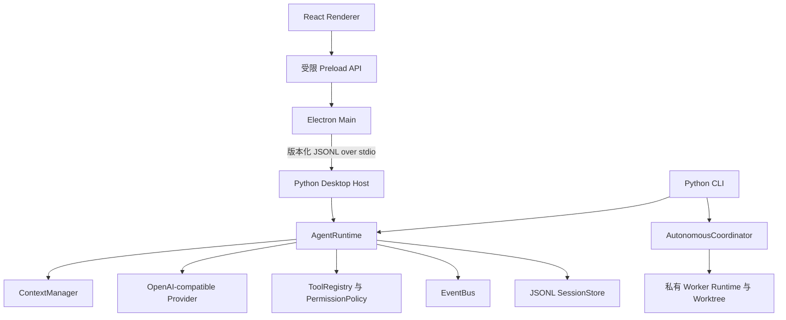

# AgentDU 架构基线

最后更新日期为 2026-11-27。源码基线为 `aacf3c2a7dc8ba5536079fbc6f848bfffa62b48e`。验收记录起始 HEAD 为 `c582fa831de4b92e456a4fefdd9f97139799b052`。

## 运行时结构

Electron、Renderer 和 Host 的职责与数据流记录在 [D1 实施记录](docs/desktop/d1-implementation.md)。Runtime 模块契约见 [现有架构说明](docs/architecture.md)。

## 桌面调用链

- Renderer 使用 React 和 TypeScript，通过 `desktop/src/preload/index.ts` 暴露的有限 API 调用主进程。它不获得 Node 集成、文件系统或通用 Shell API。
- Electron Main 在 `desktop/src/main/index.ts` 管理窗口、IPC、Host 生命周期和请求校验。Host 客户端位于 `desktop/src/main/host-client.ts`。
- Main 以参数数组和 `shell: false` 启动 Python Runtime Host。Host 通过 stdin/stdout 交换版本化 JSONL 消息，stdout 保留给协议，诊断输出走 stderr。
- 共享协议定义位于 `desktop/src/shared/protocol.ts`，Python 端位于 `src/agentdu/desktop_host.py`。协议版本为 1，包含请求响应及有序事件。
- Host 复用 `AgentRuntime`、Provider、工具注册表、事件和会话持久化能力。核心运行循环入口为 `src/agentdu/agent.py`。

## Runtime 与协作边界

- 模型调用经统一 `ChatModel` 契约进入 `src/agentdu/provider.py`。当前实现覆盖 OpenAI-compatible Chat Completions 和 Responses 协议。
- CLI 已在 `src/agentdu/cli.py` 中创建自主协调器。`src/agentdu/orchestration.py` 管理有界 Worker 调度、依赖、独立会话和结果验证。Worker 工作区由 Git Worktree 相关模块隔离。
- 桌面 Host 当前通过默认 Runtime 启动桌面任务，限制单个活动任务。桌面 Host 尚未接入 `AutonomousCoordinator`，CLI DAG 调度与固定 Handoff 流程也尚未统一成桌面任务协议。
- 会话以 JSONL 持久化。`workspace.open` 会扫描项目会话并恢复没有终态的 Desktop Host 任务。Host 级恢复测试证明任务发现不依赖 Electron Main 的内存候选表。安装版空闲 Main 异常退出的 Host 清理也有证据。活动任务期间的安装版 Main 异常退出与任务 UI 恢复仍待验证。
- 中断恢复不重放模型请求或工具副作用。损坏会话返回具体读取错误，工作区不可用时返回 `INVALID_WORKSPACE` 并保留原任务状态。

## 信任与权限边界

- Renderer 仅通过显式 Preload API 访问主进程。
- Provider 密钥由 Electron `safeStorage` 加密后保存在 Main 进程的安全存储文件。Renderer 收到公开档案元数据和 `credentialAvailable` 状态。Runtime 在启动时解密密钥并注入子进程环境。
- 文件写入、终端命令和扩展启动受 Runtime 权限策略管理。桌面 Host 的 Windows 终端执行使用 AppContainer 路径，测试覆盖项目目录访问、网络和子进程边界，记录见 D1/D2 验收文档。
- Git Worktree 用于代码状态隔离，不代表操作系统安全沙箱。
- AgentDU Provider 配置与 Codex 应用配置分离。当前 G1 使用本地合成服务证明了环境注入和认证请求，真实 Provider 编程任务尚无运行记录。

## 当前主要缺口

1. G1 隔离 profile 未修改条件失败，活动任务 Main 崩溃恢复未验证，真实 Provider 任务阻塞，细项见 [G1 验收报告](docs/desktop/g1-closeout-2026-11-27.md)。
2. 桌面没有接入 CLI 已有的自主多 Agent 调度。
3. G2 设计二次审计已规定任务级取消、Host 级资源预算、Worker 独立审批身份、TaskStateStore 单写入者与关闭顺序。实现与故障注入仍未开始，详见 [G2 Runtime 集成方案](docs/desktop/g2-runtime-integration.md)。
4. 真实 Provider 兼容性和真实编程任务尚无本地运行证据。
5. Electron Main 活动任务恢复、Provider 删除与重启失败回滚需要安装版端到端验收。

G1 关键验收通过前，Desktop Host 保持单活动任务限制，不进入 G2 实现。
