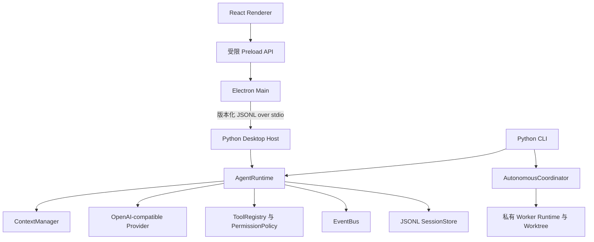

# AgentDU 架构基线

最后更新：2026-11-27
代码与自动化验证基线：`aacf3c2a7dc8ba5536079fbc6f848bfffa62b48e`

## 运行时结构

Electron、Renderer 和 Host 的职责与数据流记录在 [D1 实施记录](docs/desktop/d1-implementation.md)。Runtime 模块契约见 [现有架构说明](docs/architecture.md)。

## 桌面调用链

- Renderer 使用 React 和 TypeScript，通过 `desktop/src/preload/index.ts` 暴露的有限 API 调用主进程。它不获得 Node 集成、文件系统或通用 Shell API。
- Electron Main 在 `desktop/src/main/index.ts` 管理窗口、IPC、Host 生命周期和请求校验。Host 客户端位于 `desktop/src/main/host-client.ts`。
- Main 以参数数组和 `shell: false` 启动 Python Runtime Host。Host 通过 stdin/stdout 交换版本化 JSONL 消息，stdout 保留给协议，诊断输出走 stderr。
- 共享协议定义位于 `desktop/src/shared/protocol.ts`，Python 端位于 `src/agentdu/desktop_host.py`。协议版本为 1，包含请求响应及有序事件。
- Host 复用 `AgentRuntime`、Provider、工具注册表、事件和会话持久化能力。核心运行循环入口为 `src/agentdu/agent.py`。

## Runtime 与协作边界

- 模型调用经统一 `ChatModel` 契约进入 `src/agentdu/provider.py`。当前实现覆盖 OpenAI-compatible Chat Completions 和 Responses 协议。
- CLI 已在 `src/agentdu/cli.py` 中创建自主协调器。`src/agentdu/orchestration.py` 管理有界 Worker 调度、依赖、独立会话和结果验证。Worker 工作区由 Git Worktree 相关模块隔离。
- 桌面 Host 当前通过默认 Runtime 启动桌面任务，限制单个活动任务。桌面 Host 尚未接入 `AutonomousCoordinator`，CLI DAG 调度与固定 Handoff 流程也尚未统一成桌面任务协议。
- 会话以 JSONL 持久化。`workspace.open` 会扫描项目会话并恢复没有终态的 Desktop Host 任务。2026-11-27 新增 Host 重启后仅重新打开项目的测试，证明任务发现不依赖 Electron Main 的内存候选表。该证据覆盖 Python Host 与 IPC 路径，尚未覆盖 Electron Main 的安装版异常退出端到端流程。
- 中断恢复不重放模型请求或工具副作用。损坏会话返回具体读取错误，工作区不可用时返回 `INVALID_WORKSPACE` 并保留原任务状态。

## 信任与权限边界

- Renderer 仅通过显式 Preload API 访问主进程能力。
- 文件写入、终端命令和扩展启动受 Runtime 权限策略管理。桌面 Host 的 Windows 终端执行使用 AppContainer 路径，测试覆盖项目目录访问、网络和子进程边界，记录见 D1/D2 验收文档。
- Git Worktree 用于代码状态隔离，不代表操作系统安全沙箱。
- API 凭据通过配置指定的环境变量解析，不能存入仓库或命令行参数。AgentDU Provider 配置与 Codex 应用配置分离。

## 当前主要缺口

1. D1/D2 桌面端到端验收未完成，细项见 [实现状态](IMPLEMENTATION_STATUS.md)。
2. 桌面没有接入 CLI 已有的自主多 Agent 调度。
3. 桌面任务生命周期、恢复、并发与协作事件缺少统一协议。
4. 真实 Provider 兼容性和真实编程任务尚无本地运行证据。
5. 最新验证 SHA 的 NSIS 包已构建，安装版隔离用户数据目录、Provider 持久化和真实模型任务仍待验证。

G2 的 Host 服务边界、任务注册、事件与状态契约见 [G2 Runtime 集成方案](docs/desktop/g2-runtime-integration.md)。该文档是设计方案，Desktop Host 当前仍保持单活动任务限制。
