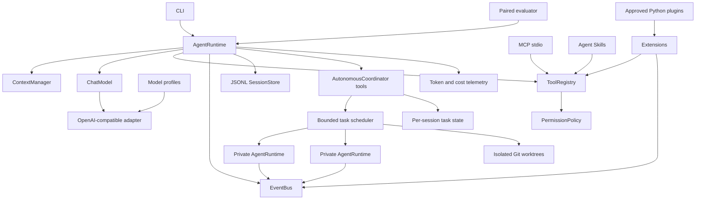

# AgentDU V0.6 Development Architecture

## Runtime Shape

`AgentRuntime.run(prompt, session_id)` is the execution entry point for the main brain and every child agent. It takes both an in-process lock and a per-session cross-process file lock, restores the transcript, closes tool calls left pending by a previous process without replaying them, appends the user message, selects a bounded request context, and calls one `ChatModel`. Assistant tool calls are persisted before execution. Each result is persisted before the next model request. The loop ends when the model returns without tool calls, returns a truncated response, fails, or reaches a configured step or provider-call limit.

## Contracts

| Module | Contract |
| --- | --- |
| `models.py` | `ChatModel.complete(messages, tools)` returns a normalized `AssistantMessage`. Streaming providers emit `ModelStreamEvent` values. Provider-specific request and response types stay outside the loop. |
| `provider.py` | `OpenAICompatibleModel` maps the normalized contract to Chat Completions JSON or SSE, reassembles streamed tool calls, and classifies transient HTTP and transport errors for bounded retry. It uses Python's standard-library HTTP client. |
| `settings.py` | TOML profiles select an OpenAI-compatible base URL, model, environment variable for an API key, timeout, temperature, streaming mode, optional capability hints, usage capture, and optional input/output prices. MCP stdio servers are also configured here. CLI flags and environment variables provide overrides. |
| `tools.py` | `ToolRegistry` publishes JSON Schema function definitions, validates the supported schema subset, requests permission, and executes registered handlers. Built-ins list, search, read, and edit workspace files, write one file atomically, run shell commands, and inspect Git status/diff/log. |
| `permissions.py` | `PermissionPolicy.authorize(request)` is the policy boundary. The CLI allows reads and asks before collaboration, writes, or execution. `--yes` approves these actions for the run. |
| `sessions.py` | Each session is an append-only JSONL event file with contiguous sequence numbers. A per-session OS file lock serializes writers across processes. Incomplete final records are repaired before the next append. |
| `events.py` | Lifecycle events are persisted once and then delivered to extension observers. Streaming text deltas are delivered to observers but are not stored as separate events. Observer exceptions are logged and do not stop the agent run. |
| `context.py` | A conservative character estimate selects complete recent turns and accounts for tool schemas while retaining system instructions and matched tool-call/result groups. The canonical transcript remains intact. |
| `extensions.py` | An extension registers tools and subscribes to lifecycle events. `plugins.py` loads explicitly named installed entry points after execution approval and checks extension API version 1. |
| `mcp.py` | `MCPStdioClient` negotiates a supported protocol version, lists tools with cursor pagination, enforces message and pending-queue bounds, filters subprocess environment values, and shuts down approved local server processes. |
| `skills.py` | `SkillsExtension` discovers `SKILL.md`, initially exposes metadata, then loads instructions or UTF-8 text resources from within the skill directory. Frontmatter parsing supports a constrained subset for the required metadata fields. |
| `security.py` | Known credential values are removed from child environments and redacted from structured session and tool data. This is not operating-system process isolation. |
| `evaluation.py` | Paired solo/collaborative runs use separate clean Git workspaces with matching tree hashes and record elapsed time, request/token counts, optional estimated cost, and acceptance-check results. |
| `collaboration.py` | `HandoffCoordinator` retains the V0.4 fixed source-to-receiver workflow with separate profiles, sessions, and Git worktrees. |
| `orchestration.py` | `AutonomousCoordinator` exposes asynchronous implementation, consultation, review, status, result, wait, and integration tools only to the main brain. It maintains per-session task state, dependency gates, bounded concurrency and model-request budgets, child progress, result snapshots, and non-recursive private AgentRuntime instances. |
| `handoff.py` | `HandoffLedger` persists versioned state transitions and execution evidence as JSONL events. Expected versions and owners are checked before transitions. |
| `git_workspaces.py` | `GitWorkspaces` creates isolated branch and read-only worktrees, hashes immutable snapshots, verifies task results, and tests merge candidates away from the main worktree. Integration advances the main branch only after acceptance commands pass and the main baseline remains a descendant. A repository-level process lock serializes collaboration Git operations. |

Each `AgentRuntime` has one model. V0.4 creates two independent runtimes in sequence. The source agent's conversation remains in its private session. The receiver sees the original task and a bounded package containing the source report, source and base commit IDs, changed files, a SHA-256 digest of the source diff, command evidence, and explicit acceptance commands. The user-facing coordinator session records state changes and final reports without concatenating private transcripts.

## V0.5 Smart Autonomous Mode

When the configuration provides a profile with a distinct endpoint-and-model pair, the CLI installs collaboration tools into the main `AgentRuntime`. The main brain retains every ordinary coding tool and chooses whether to work independently, request bounded consultation, dispatch an implementation, request an independent review, or integrate a completed result. Profile capability strings are hints for model selection. AgentDU does not benchmark profiles or infer their strengths.

Implementation and review dispatch require a Git repository with an initial commit and a clean main worktree. Each task gets a unique worktree rooted at the current `HEAD`, a private session transcript, a profile owner while running, and a versioned status record. The main agent can edit its checkout after dispatch. A later task dispatch or integration requires the main checkout to be clean, so the main agent must commit its own changes before those operations.

The default scheduler limits are two concurrent workers, eight tasks per user session, 80 child provider requests per session, and 20 provider requests per task. The provider-request budget counts retries and does not estimate monetary cost. The main runtime has a separate model-step budget. A task can depend only on existing tasks in the same user session, which prevents dependency cycles. Consultation and review dependencies require completion. Implementation dependencies require integration before they can start. Failed prerequisites block their dependent tasks.

Consultation uses only the question and bounded context supplied by the main brain, has no registered tools, and persists its own transcript. A review uses a separate read-only worktree and policy. An implementation agent uses its own Git branch, private context, and the configured permission policy. Child runtimes never receive the collaboration tools, so recursive delegation is unavailable.

Progress events are published to the main session event bus while each task's bounded event history and state are atomically persisted under `.agentdu/agents/<session-id>/tasks.json`. Task completion captures the branch commit, changed-file list, and binary diff digest. `get_agent_task_result` revalidates the stored snapshot before exposing it.

`integrate_agent_task` requires one or more acceptance commands. AgentDU merges the worker commit into an isolated candidate worktree based on the current main `HEAD`, runs the checks there under the execution permission policy, verifies the candidate did not change during the checks, creates an integration commit, and fast-forwards the main branch only if its `HEAD` is still unchanged. A conflict or failed check leaves the main worktree untouched. Candidate and worker worktrees remain for audit. The CLI completes already-started and runnable queued tasks before exiting, and marks tasks whose dependency was not integrated as blocked.

The task status flow is `queued -> running -> completed -> integrating -> integrated`. Consultation and review finish at `completed`. Errors lead to `failed`; failed or interrupted prerequisites lead to `blocked`. A process restart marks queued and running tasks as `interrupted`. Their worktrees remain available for inspection, and AgentDU does not resume an uncertain model turn automatically.

The handoff state machine is `source_running -> offered -> accepted -> receiver_running -> verified -> integrated`, with `offered -> rejected` available when the receiving model declines or fails to acknowledge. The source owns the record until it offers its result. The receiver must explicitly return `Handoff: ACCEPT` during a read-only AgentRuntime turn before ownership transfers. The coordinator owns stale, abandoned, failed, rejected, and integrated terminal states. Every transition checks the expected state version and current owner. Evidence events are tied to the current owner and version. At least one explicit `--check` command is required, each must succeed, and any remaining change in the receiver worktree prevents integration.

Handoff starts from a clean Git worktree with an initial commit. Agents work in distinct Git worktrees. AgentDU hashes and rechecks each commit snapshot, and the coordinator fast-forwards only if the original branch still points at the baseline and remains clean. A persisted verified result is reconciled on the next run if a process stopped after Git integration but before the terminal ledger event. Incomplete non-verified records block another handoff until explicitly abandoned.

## Decisions And Evidence

The research library records source snapshots downloaded on 2026-11-22. Commit identifiers below come from the original ZIP comment or tar archive metadata. Paths are relative to `agent-learning-library/sources/`.

| Project and snapshot | Local source evidence | V0.2 decision |
| --- | --- | --- |
| Pi `9c4652688590abb836b40ebd1e4725ecf9a7c7d1` | `pi/packages/agent/src/agent-loop.ts` `runLoop`, `streamAssistantResponse`, and `executeToolCallsParallel`; tool schema validation and before/after hooks are in the same file. | Keep model I/O behind a contract and persist tool-call/result order. V0.2 executes calls serially while recovery semantics are established. |
| Codex CLI `1476a08f1b410e359e64becf2494bc248743e396` | `codex/codex-rs/core/src/exec_policy.rs` approval and sandbox policy; `codex/codex-rs/core/src/apply_patch.rs` delegates patch approval to tool runtime. | Treat approval as policy input to tool execution. AgentDU currently has path confinement and human approval, without an OS sandbox. |
| DeepSeek Harness `d98f5d68519215da48f3002da2cb9c9d2068d81d` | `deepseek-harness/packages/core/agent-loop/src/agent.ts` streams and settles assistant attempts around tool calls; `packages/session/session-persistence-jsonl/src/index.ts` uses write leases for session ownership. | Use an append-only event transcript, a per-session writer lock, and interruption results that do not replay uncertain actions. |
| OpenCode `5310e42203af41c3452ee44b24fc7d0c52aaa3cc` | `opencode/packages/core/src/session/runner/step.ts` consumes provider streams, schedules tools, and settles cancellation; `permission.ts` evaluates allow/ask/deny rules. | Keep permission decisions in a distinct policy module and stream assistant deltas. Provider cancellation before response headers and OS-level command isolation remain limitations. |
| Aider `5dc9490bb35f9729ef2c95d00a19ccd30c26339c` | `aider/aider/coders/base_coder.py` `check_tokens`, `send_message`, retry, and history summarization; `coders/editblock_coder.py` applies matched edits and can report partial success. | Preserve the full canonical transcript while bounding request context, retry transient provider failures, and use exact-match edits. Semantic summarization, Git commits, and transactional multi-file edits are not implemented. |
| Cline `8075d2e35cf5cad67c24f180c80a05d311b74a3e` | `cline/sdk/packages/agents/src/agent-runtime.ts` `run`, `executeToolCalls`, and `prepareToolExecution`; absent approval callback is an explicit denial. `sdk/ARCHITECTURE.md` assigns compaction to core. | Separate runtime, provider, tools, and context ownership. Require a live approval callback for interactive writes and command execution. |
| Goose `36b29113aff691e1a46a21a5c25900824caf9949` | `goose/crates/goose/src/agents/state_machine/session.rs` runs the state machine and tool hooks; `state_machine/ops_toolcalling.rs` owns tool-call operations. | Keep extension registration and event observers outside model transport. Full state-machine scheduling is not needed for the single-agent baseline. |
| OpenHands `7eb410802717996cf568deb67faee224863219ec` | `openhands/src/api/` is the Canvas API snapshot; the companion SDK `software-agent-sdk/openhands-sdk/openhands/sdk/conversation/event_store.py` `EventLog` indexes persistent events, and `conversation/impl/local_conversation.py` exposes run/message lifecycle. SDK snapshot `74f198df3650da6399c6a0a2dff6272a667bbace`. | Keep a durable event log as the session source of truth. AgentDU uses a smaller JSONL projection and does not copy OpenHands code. |

These are source-level design references, not claims that the upstream projects were executed in this environment. The reference projects are not runtime dependencies, and no third-party source code was copied into AgentDU.

## Runtime And Persistence Guarantees

- Assistant tool-call messages are persisted before any tool starts. Each tool result is persisted before the next model request.
- If the process stops after a tool call was recorded but before its result, resume appends an interruption result that tells the model the operation may have completed. AgentDU does not replay that action automatically.
- Same-session runs from `AgentRuntime` instances and CLI processes are serialized. Sequence numbers are refreshed after acquiring the process lock.
- Event observers run in registration order. An observer failure is logged and isolated from the execution loop.
- Tool outputs are limited to 16,000 characters. The context selector estimates ASCII as four JSON characters per token and each non-ASCII character as three tokens, counts the serialized tool schemas, and never splits a retained user turn or tool exchange. This is a conservative heuristic, not provider-tokenizer accounting.

## Known Boundaries

- The provider adapter supports only the OpenAI-compatible Chat Completions tool-calling shape. Tests use local HTTP fixtures. Compatibility with live OpenAI-compatible providers, their rate limits, and model-specific tool-call behavior has not been verified against external credentials.
- Context management drops old whole turns or complete assistant/tool exchanges and inserts an omission notice. It does not generate semantic summaries or use provider tokenizers. A latest turn or tool schema too large for the configured budget fails explicitly.
- The shell tool is not an OS sandbox. A command runs with the user's permissions and can leave the workspace after the user approves it. Path checks constrain file tools only.
- A crash during external command execution leaves its final effect uncertain. The session records that uncertainty and will not replay the call automatically.
- File writes use atomic replacement for one file. There is no multi-file transaction, diff review UI, Git checkpoint, or automatic validation stage. The agent must use command and Git tools to run tests and inspect changes.
- A shell command that exits after starting a child which keeps stdout open triggers process-tree cleanup and a warning. On Windows, descendants may survive if the shell already exited before cleanup could reach them.
- Streaming cancellation closes an established HTTP response. Cancellation while waiting for connection setup or response headers can wait for the configured network timeout. Approved tool execution is allowed to settle before session locks are released.
- V0.5 profile selection is based on configured names and optional capability hints. No live comparative quality, latency, or cost data is collected, and a profile's hints are not verified.
- Collaboration call budgets count provider requests. They do not estimate or limit dollars, token charges, or provider-specific pricing. The main model's calls are governed separately by its step limit.
- V0.5 task state and child sessions are local to one AgentDU process. A restart marks active and queued tasks interrupted rather than resuming model execution. Worker and candidate worktrees are retained and not automatically pruned.
- The main checkout must be clean when implementation/review tasks are dispatched and when results are integrated. The main agent may continue to work while agents run, then commit its work before dispatching further Git tasks or integrating.
- Acceptance commands run as the current user. A failed check or Git conflict leaves the main checkout unchanged, but the candidate worktree and any external side effects of the command may remain.
- V0.4's fixed two-role handoff remains available through `--handoff-profile`; V0.5 autonomous tasks use their own task state and integration path.
- A Git worktree is a version-control workspace boundary, not an OS security boundary. An approved shell command can modify another worktree, the original checkout, Git metadata, or files outside the project. Concurrent or malicious out-of-worktree shell writes cannot be reliably detected by the current baseline checks.
- Multi-model mode requires an initial Git commit and a clean original worktree. It leaves handoff branches and worktrees for audit and does not automatically prune them.
- Handoff acceptance text is a model claim. AgentDU independently verifies commit lineage, diff hashes, clean state, and explicit shell acceptance commands, but it cannot prove that the receiver's qualitative code review is correct.
- Provider tests use local deterministic endpoints. No two live external providers or models have been validated with credentials in this environment.
- The V0.6 MCP client is stdio-only and exposes tools only. Skills parsing handles a constrained frontmatter subset. Python plugins execute in-process after approval and are not isolated.
- Package installation uses `setuptools` as a build dependency. The source-tree CLI and tests run with Python's standard library.

## V0.4 Completion Assessment

The handoff protocol, separate model contexts, versioned record, Git snapshot verification, receiver acceptance, explicit command checks, and fast-forward integration are implemented and covered by local endpoint integration tests. V0.4 is ready for architecture review and further provider trials. It does not meet a strict security-isolation requirement for model-issued shell commands, and actual multi-provider model relay remains unverified until credentials and provider endpoints are configured. Those two conditions must be resolved or explicitly accepted before claiming complete real-world multi-model reliability.

The full V0.1 project-by-project reports were not present in the repository when V0.2 work began. This decision record captures source locations checked for the choices above; it does not mark the requested V0.1 research package complete.

## V0.5 Completion Assessment

Automated tests use local OpenAI-compatible fixtures to run two implementation agents concurrently while the main agent edits and commits a separate file. The main agent then integrates both results after acceptance checks. A dependent reviewer starts only after its implementation result is integrated, and its attempted write is denied. Additional tests cover a context-only consultation, task and model-request budgets, failed-check rollback, and merge-conflict rollback. This is real local execution over temporary Git repositories, not a live external-model evaluation.

No provider credentials or configured live profiles were available for an external multi-model development run or a comparable `--solo` baseline. AgentDU has demonstrated the collaboration protocol and filesystem/Git effects against deterministic local model fixtures. It has not established that autonomous collaboration improves task quality, wall-clock time, or cost with real providers. The shell boundary also remains policy approval plus worktree organization, not operating-system isolation.

## V0.6 Development Assessment

V0.6 adds local recovery and handoff entry points, token and optional price telemetry, subprocess credential filtering, MCP stdio tools, progressive skills loading, explicitly approved Python entry-point extensions, and a paired evaluator. These capabilities are covered by local tests and described in [v0.6-status.md](v0.6-status.md). The evaluator has not been run against live providers. Shell commands remain unsandboxed, the interface remains CLI-only, resource limits are process-local, and cross-model data classification is absent. V0.6 therefore remains under development and has not passed independent product acceptance.
