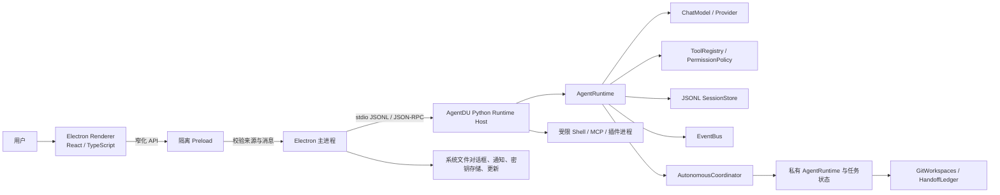
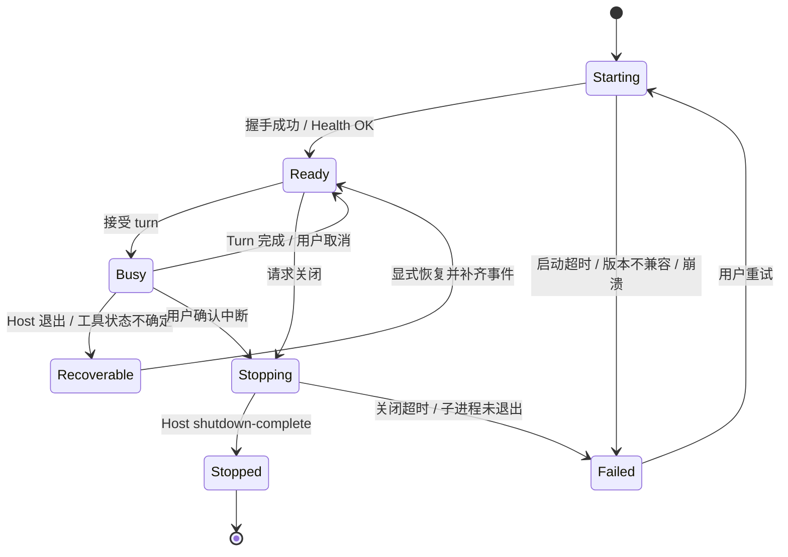

# AgentDU Desktop 总体架构

## 架构决定

**架构采用** Electron 主进程、React/TypeScript Renderer 和独立 Python Runtime 子进程。桌面 UI 通过版本化 JSON-RPC/JSONL 消息连接 Runtime。所有会话、工具、Agent Loop、协作和 Git 状态继续由 AgentDU Runtime 拥有。

**决定依据来自** AgentDU 已经采用 Python Runtime，Electron 可提供成熟的 Windows 桌面、窗口、系统通知、应用更新和跨平台界面能力。公开 Codex App Server 与 Harness Desktop 都提供了“桌面客户端和 Agent Host 使用明确进程/协议边界”的研究案例。选择 Electron 是 D0 的产品工程判断，尚无运行验证的性能结论。

**安全方案尚未定案。** Windows Shell 与子进程必须具备可测试的 OS 级限制。D1 首先做命令执行隔离技术验证，比较 Windows Job Objects、受限令牌、AppContainer 或仍在维护的第三方 sandbox 能力，再确定跨平台能力模型。普通子进程启动或 Git worktree 不构成安全沙箱。

## 组件图



图中 Runtime 和工具执行已有部分来自当前源码。Electron 主进程、Preload、Runtime Host、IPC、密钥存储和 OS 沙箱均为新增设计。

## 进程边界与职责

### Electron Renderer

- 显示项目、会话、Agent 任务、Diff、终端输出和设置。
- 不持有 Provider 凭据，不直接调用 Node、文件系统、Shell、子进程或任意本地 URL。
- 仅能通过明确列出的 preload API 发送业务请求并订阅事件。
- 将服务器推送的事件转换为可审查的时间线，不推断缺失的运行事实。

### Preload 与 Electron 主进程

- Preload 开启 context isolation 与 sandbox，仅暴露窄化的类型化 API。
- 主进程验证消息来源、协议版本、参数大小和调用权限。
- 主进程拥有 Python Runtime 的启动、进程句柄、重启策略、退出码、日志、文件选择器、系统通知、更新和密钥存储。
- 主进程调用 Runtime 时不通过命令行拼接用户输入。Python 路径和启动参数使用已解析的绝对路径及参数数组。
- Electron 官方指南要求谨慎处理远程内容、Node integration、context isolation、进程 sandbox、CSP 和导航。AgentDU Renderer 应只加载随包或本地可信内容。

### Python Runtime Host

- 新增轻量 Host 层，负责 IPC 解码、握手、方法路由、请求去重、并发、事件序号、健康状态和关闭。
- 直接组合已有 `AgentRuntime`、`ModelSettings`、`SessionStore`、`AutonomousCoordinator`、`HandoffCoordinator`、`ToolRegistry` 与扩展。
- Host 是桌面 UI 的入口，不把 CLI 的 argparse 与交互式终端审批直接挪进 UI。
- stdout 仅用于协议帧，诊断日志写入 stderr 或滚动日志文件。输出帧需限制大小并对不可信数据编码。
- Host 不在崩溃后自动重放正在运行的模型 turn 或外部命令。恢复逻辑先读取持久状态，再将不确定操作显示给用户。

### Runtime 与工具隔离

- Agent Loop 和已有工具实现留在 AgentDU Runtime。
- 文件 API 以 workspace allowlist 为根。Shell 与测试命令另经受限执行服务，不由 Renderer 直接启动。
- 高风险命令的审批请求包含解析后的 executable、参数数组、工作目录、网络策略、目标模型、任务和权限范围。
- MCP Server、Python Plugin 和子 Agent 凭据按需注入且相互隔离。Worker 环境不继承未授权 Provider 密钥。
- 每个实现 Agent 使用独立 Git worktree 和私有 session，结果通过 commit、Diff 摘要、检查命令和验收日志交回。

## IPC 协议草案

协议使用 UTF-8 JSON Lines，通过子进程 stdin/stdout 双向通信。单帧为一个 JSON 对象加换行。Transport 层不能把交互式 CLI 输出或日志混入 stdout。

### 基础消息形状

```json
{"type":"request","protocolVersion":1,"requestId":"req-001","method":"session.list","params":{}}
{"type":"response","protocolVersion":1,"requestId":"req-001","result":{"sessions":[]}}
{"type":"event","protocolVersion":1,"eventId":"evt-001","sessionId":"session-001","sequence":12,"event":"turn.started","payload":{"turnId":"turn-001"}}
{"type":"request","protocolVersion":1,"requestId":"req-002","method":"permission.respond","params":{"approvalId":"approval-001","decision":"deny"}}
```

### 最小方法组

| 方法 | 用途 |
| --- | --- |
| `host.initialize` | 协议版本、Runtime 版本、能力集和数据目录协商 |
| `host.health` | Host、模型配置、会话存储和任务执行器状态 |
| `workspace.open` / `workspace.list` | 打开并管理本地工作区 |
| `session.list` / `session.create` / `session.read` | 会话查看与恢复 |
| `turn.start` / `turn.cancel` | 开始用户任务和请求取消 |
| `permission.respond` | 处理待审批的工具操作 |
| `task.list` / `task.read` / `task.resume` | 自主 Agent 任务状态和显式恢复 |
| `git.diff` / `task.integrate` | 读取受审查 Diff 与验证后集成 |
| `provider.list` / `provider.validate` | Provider Profile 状态和连通性验证 |
| `settings.read` / `settings.update` | 修改桌面设置与 Runtime Profile |
| `host.shutdown` | 安全关闭并返回未完成任务清单 |

### 协议可靠性要求

- 握手包含协议主/次版本、Runtime 版本、应用版本、最大帧字节数和能力集。
- 每个请求使用唯一 ID。重复请求需定义幂等性，避免用户界面重试重复创建 turn 或重复写文件。
- 事件带单调递增的会话序号，断线后用 `session.read` 补齐缺失事件。
- 每种事件都有 schema 和兼容规则。未知事件允许记录并忽略，未知请求方法返回结构化错误。
- Approval 有超时和拒绝默认值。应用关闭不会隐式批准。
- stdout 无效 JSON、帧超限、协议版本不兼容或事件序号冲突时进入可见故障状态，不继续执行写操作。
- Host 重启后读取已持久化 Session 与任务状态，未完成 tool call 复用当前的 interrupted 语义，不重复执行。
- 运行多个 Runtime Host 的设计不作为首版要求。第一版采用单 Host、多 session、多任务，并为未来隔离 Host 保留 `runtimeId`。

## 现有模块映射

| 处理方式 | 模块 | 依据与具体动作 |
| --- | --- | --- |
| 直接复用 | `agent.py`、`models.py`、`events.py` | 保留 `AgentRuntime.run`、`ChatModel` 及流式事件的主体行为 |
| 直接复用 | `sessions.py`、`context.py` | 保留 JSONL 追加记录、会话锁、上下文预算和未完成工具调用恢复 |
| 直接复用 | `handoff.py`、`collaboration.py`、`git_workspaces.py` | 保留版本化交接、worktree、snapshot 校验和验证后集成 |
| 直接复用 | `orchestration.py` | 保留有限预算、依赖、任务状态、后台 Worker 与结果重验逻辑 |
| 接口适配 | `cli.py` | CLI 留作开发与诊断入口。为桌面增加应用服务层，不复用终端提示和 argparse 作为 UI API |
| 接口适配 | `permissions.py`、`tools.py` | 将 callback/终端审批映射成可持久查询的桌面审批事件。补齐逐工具权限、取消和审计数据 |
| 接口适配 | `settings.py`、`provider.py` | TOML/Profile 作为兼容输入保留，凭据移入系统存储。Provider 接口从 OpenAI 兼容模型逐步扩展到真实多协议 Adapter |
| 安全重构 | Shell、MCP 与插件执行路径 | 现有审批、密钥过滤和输出限制不构成 OS 隔离。建立外部受限执行进程并验证平台安全能力 |
| 新增 | `desktop/` Electron 工程 | Renderer、Preload、主进程、安装包、窗口生命周期、通知、更新和 UI 本地化 |
| 新增 | `desktop_host` 与消息 schema | 用版本化本地 IPC 将桌面 UI 映射到 Runtime 应用服务 |
| 新增 | 任务与会话查询投影 | 支持 UI 分页、搜索、状态筛选、断线补事件和本地通知 |
| 新增 | OS 密钥存储和执行沙箱 | 保护 Provider 凭据，约束文件、Shell、网络和子进程能力 |
| 新增 | 可视化审查与恢复工作流 | Diff、审批、失败恢复、手动接管、任务重开和明确集成确认 |

## 生命周期状态



## 存储与数据归属

| 数据 | 建议归属 | 规则 |
| --- | --- | --- |
| Agent 事件与对话 | 工作区 `.agentdu/sessions/` 或已配置的数据根 | 保留 SessionStore JSONL 为源事实，桌面数据库仅做可重建索引 |
| Agent 协作任务 | 工作区 `.agentdu/agents/` | 延续 task state、worktree 和审计证据，启动时恢复状态 |
| 桌面偏好 | 用户应用数据目录 | 语言、主题、窗口布局、最近项目和通知选择，与 Runtime 会话分开 |
| API 凭据 | Windows Credential Manager、macOS Keychain、Linux Secret Service 等系统密钥存储 | Profile 保存凭据引用，不将明文写入工作区或 Renderer |
| 日志和崩溃报告 | 用户应用日志目录 | 限长、轮转、脱敏，用户可查看和删除 |
| 临时执行数据 | 独立临时目录 | 记录 owner、任务、基线和清理时间，崩溃后可审查后清理 |

具体平台 API 和跨平台凭据依赖待 D1 做兼容性验证。

## 安全威胁与缓解

| 威胁 | 当前风险 | 设计缓解与验收 |
| --- | --- | --- |
| Renderer XSS 访问本机 | Electron renderer 若获得 Node 或宽泛桥接会放大影响 | context isolation、进程 sandbox、CSP、来源校验、参数 schema、限制导航与外链 |
| Agent Shell 越出工作区 | 当前批准后的 Shell 以用户权限执行 | OS 级执行隔离，约束文件和网络，进程树归组，审批显示真实命令 |
| Provider 密钥外泄 | 密钥可能被日志、任务环境、插件或子进程看到 | 系统密钥存储、最小化注入、子进程环境 allowlist、凭据脱敏回归测试 |
| 模型间敏感数据扩散 | 子 Agent 可接触分配给它的上下文和 worktree | 任务委派前展示数据包，移除密钥和个人数据，逐模型记录数据发送摘要 |
| 本地 Host 被其他应用调用 | loopback 服务可能被本地恶意进程探测 | 首选无端口 stdio IPC。若用 loopback，使用随机高熵启动凭据、请求来源校验和限制绑定地址 |
| 崩溃后副作用重复 | 命令可能已执行，但回执未写入日志 | 不自动重放，区分 uncertain 状态，恢复前读取 Git/文件/进程证据 |
| 恶意 MCP 或插件 | 任意扩展代码可能继承 Runtime 权限 | 执行隔离、权限清单、扩展来源和版本提示、显式授权、卸载和审计 |
| 工作区指令注入 | 源码、Skills、项目说明可能包含不可信 Agent 指令 | 将工作区内容视为不可信输入，模型上下文与 UI 权限策略分离 |

## 主要风险和待验证决策

1. Windows 上实际可用且维护成本可接受的进程、文件、网络隔离方式。
2. Python Runtime 打包为目录/嵌入式分发包时，启动时间、安装尺寸、升级与签名路径。
3. JSONL 事件和文件锁在 UI 查询、后台 Worker 与恢复并发场景下的读取模型。
4. Provider 原生认证是否完全通过 API Key，或未来需要浏览器 OAuth 和系统网页登录。
5. Git 安装缺失、工作区不在 Git 仓库、Submodule、Git LFS、符号链接与大型仓库的 UI 行为。
6. Linux 系统密钥存储、通知和打包方式的发行版兼容范围。
7. 开启后台任务后，系统关机、更新、用户注销和休眠的任务保证。
