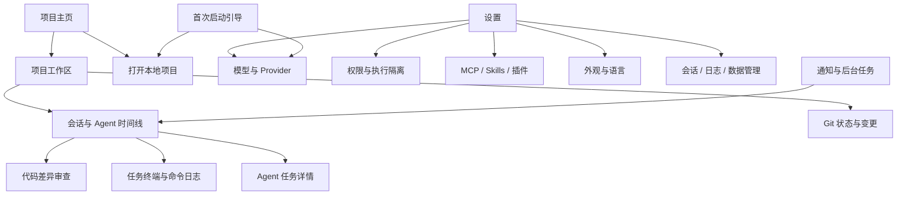

# AgentDU Desktop 页面结构与交互

本文是 D0 交互规格，不是已实现界面。产品首版以 Windows 和简体中文为默认验收基线。

## 全局框架

```text
┌───────────────────────────────────────────────────────────────────────────┐
│ 顶栏  项目 / 分支 / Runtime 状态 / Agent 运行状态 / 设置 / 通知          │
├────────────────┬───────────────────────────────────┬──────────────────────┤
│ 项目与会话导航 │ 主工作区                           │ 上下文侧栏           │
│                │                                   │                      │
│ 最近项目       │ 对话、计划、工具活动、任务结果     │ 文件 / Git Diff      │
│ 当前项目       │ Agent 时间线或代码编辑/审查         │ Agent / 任务详情     │
│   任务会话     │                                   │ 工具与权限           │
│ 工作 Agent     │                                   │ 执行日志             │
├────────────────┴───────────────────────────────────┴──────────────────────┤
│ Composer  模型选择 / 权限模式 / 输入 / 附件 / 发送 / 停止                  │
└───────────────────────────────────────────────────────────────────────────┘
```

窗口支持拖拽调整左右区域；侧栏宽度、打开的会话和未发送草稿持久化。不同屏幕尺寸下右侧面板可收起，活动时间线优先保留。

## 页面树



## 页面定义

### 1. 首次启动与项目主页

- 初次启动时检测 Runtime、Git、可用 Provider 配置和必要系统能力。
- 若无 Provider，允许先看演示数据或设置模型，不发出模型请求。
- 主按钮打开项目目录。最近项目显示路径、分支、最近会话和最后一次任务状态。
- Runtime 启动失败、缺少 Git、数据目录不可写时展示具体修复信息。
- 首启语言根据系统语言选择 `zh-CN`，设置中可切换英文并立即生效。

### 2. 项目工作区

- 顶部显示项目名、根路径、当前分支与工作区健康状态。
- 左侧显示项目、会话历史、活动 Agent 和任务筛选。
- 中央默认是当前会话时间线，支持对话与任务活动混合呈现。
- 右侧上下文侧栏提供文件列表、Git 状态、Diff、Agent 任务和审批。
- 底部 Composer 选择主模型、输入任务、附加文件、发送或停止。
- 终端和日志面板区分 Agent 命令与用户手动命令，显示退出码与工作目录。

### 3. 会话和任务时间线

每条活动显示时间、归属 Agent、模型标识、活动类型、状态和证据入口。事件类型至少包括用户输入、助手增量文本、工具开始/完成、命令输出、权限请求、Agent 任务状态、Git 变更、测试结果、错误与恢复动作。

时间线只展示产品允许展示的任务进展和可验证活动，不要求暴露模型私有推理过程。模型调用是否成功、工具是否实际运行、命令的退出码和验收状态必须分开展示。

### 4. Agent 协作面板

- 显示主 Agent 和子 Agent 任务卡片，包含任务目标、模型、角色、状态、依赖和工作区。
- 任务状态使用 `排队中`、`运行中`、`需要审批`、`待接收`、`验证中`、`已完成`、`失败`、`中断`、`结果过期`、`已集成` 等明确状态。
- Handoff 视图展示发送方、接收方、接受确认、基线 SHA、结果 SHA、变更摘要、证据与未解决问题。
- 用户可查看完整 Git Diff 和验收结果，执行接受、拒绝、重新运行检查或丢弃任务工作区。
- 主 Agent 可以继续执行时，页面继续接受输入和显示其工作；任务阻塞时明确显示依赖原因。
- 不显示私有对话日志全文，除非后续产品权限和数据策略明确授权。

### 5. Diff 审查

- 文件列表显示新增、修改、删除、重命名和冲突状态。
- 行内 Diff 显示来源任务和 Agent。用户能切换文件、评论差异、复制路径和打开外部编辑器。
- 展示基线和结果 commit、Diff digest、验收命令、退出码和运行时间。
- 集成前重新计算结果摘要并再次验证主工作区基线。
- 检查失败或冲突时阻止“集成”按钮，并显示可重试的独立操作。

### 6. 权限审批

审批卡展示请求来源模型、工具名称、请求参数、执行目录、权限边界、影响路径、网络需求和数据发送对象。支持本次允许、拒绝、查看完整详情。持久授权需在设置页单独配置，默认最小权限。

执行超时后或用户离开应用时，未决审批保持待处理或按拒绝处理。界面必须将“模型请求了某操作”与“操作已经执行”区分。

### 7. 模型与 Provider 设置

- 创建、编辑、测试、设为默认和删除 Profile。
- 字段包括 Provider 类型、Endpoint、Model ID、凭据引用、流式、超时、能力、输入输出价格和连接状态。
- 密钥输入始终遮蔽，不允许在 Renderer 持久化明文。
- 显示 Runtime 实际支持的模型协议和功能，不把 capability tag 作为已验证模型能力。
- Provider 验证在无会话修改的隔离检查中运行，显示错误类型、耗时和模型响应格式。

### 8. 权限与执行隔离设置

- 按读取、写入、Shell、Git、网络、MCP、插件和跨模型数据分别配置策略。
- 默认使用询问模式。`全局自动批准` 这类宽权限选项需要明确范围和再次确认。
- 展示允许路径、拒绝路径、网络策略、命令超时和日志保留时间。
- 显示 OS 沙箱能力状态及平台限制。无法启用要求的隔离时，明确禁止或要求用户选择低风险模式。

### 9. MCP、Skills 与插件

- MCP 页面管理 Server 命令、工作目录、环境变量引用、可用工具和授权范围。
- Skills 页面展示来源目录、名称、描述、资源访问范围、启用状态和最近加载记录。
- 插件页面展示包来源、版本、API 兼容性、签名/来源信息、注册工具和危险权限。
- 不在静默状态下加载未知插件代码。卸载和禁用操作显示受影响的会话能力。

### 10. 通知与后台任务

- 通知点击后定位到对应项目和任务。
- 任务完成、等待审批、失败和恢复需要用户操作时产生通知。
- 任务取消、应用退出和系统关机前显示会被中断的任务和未完成命令。
- 用户可以控制通知、后台运行、关窗行为及退出时的确认方式。

## 关键用户流程

### 单模型修改

打开项目 → 选择模型与权限模式 → 描述任务 → 查看工具活动 → 处理审批 → 查看测试证据 → 审查 Diff → 接受并结束。

### 多模型实现与集成

主 Agent 分析任务 → 创建独立 Agent 任务并显示基线 → 子 Agent 在专属 worktree 执行 → 结果回传并核验快照 → 主 Agent 或用户检查 Diff 与测试 → 在无冲突条件下集成。

### 进程重启恢复

启动检查会话文件、Runtime 版本和任务状态 → 加载事件 → 将未决模型调用显示为中断或不确定 → 检查 Git worktree 与执行证据 → 用户选择继续、重新委派、检查或清理。

## 中文文案和状态词

| 英文概念 | 推荐中文 |
| --- | --- |
| Workspace | 工作区 |
| Thread / Session | 会话 |
| Turn | 轮次 |
| Agent Task | Agent 任务 |
| Handoff | 任务交接 |
| Worktree | Git 工作区 |
| Approval | 操作审批 |
| Diff Review | 差异审查 |
| Interrupted | 中断 |
| Uncertain | 状态不确定 |
| Stale Baseline | 基线已过期 |
| Integrated | 已集成 |
